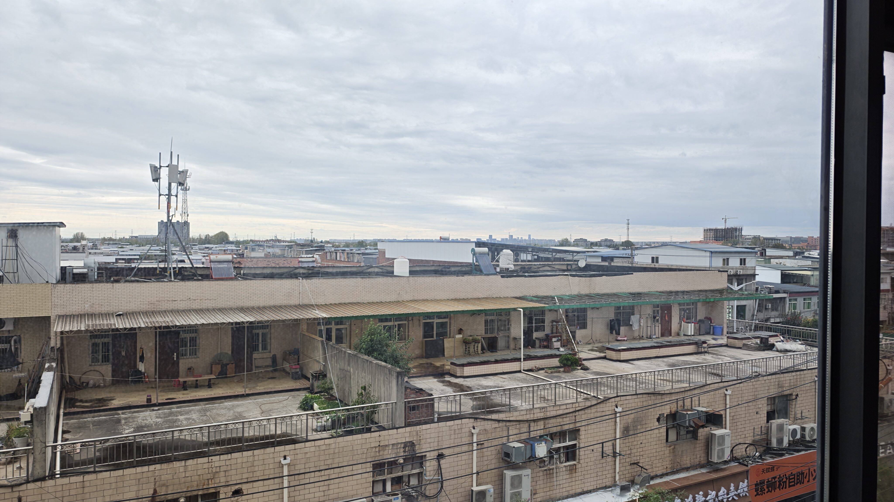
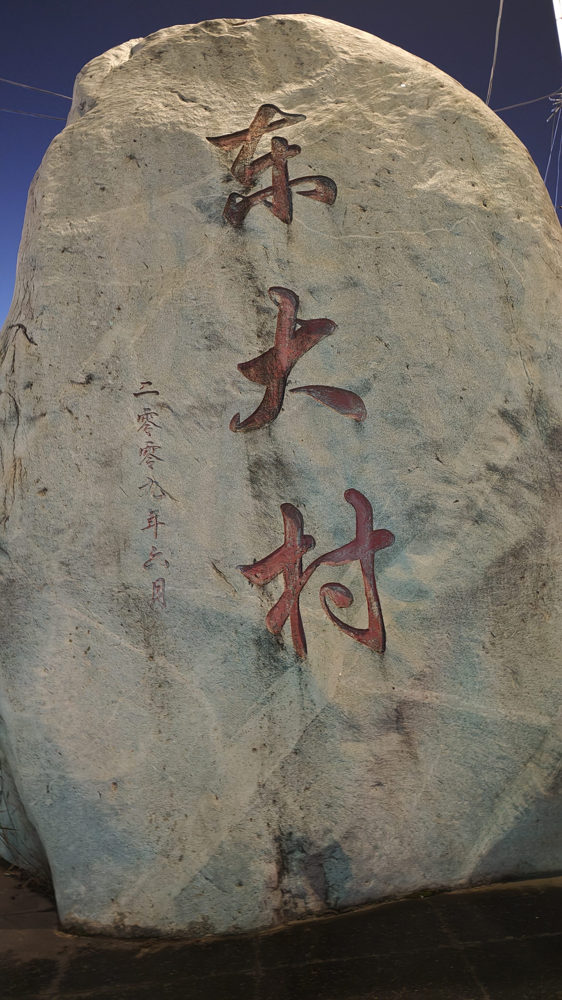
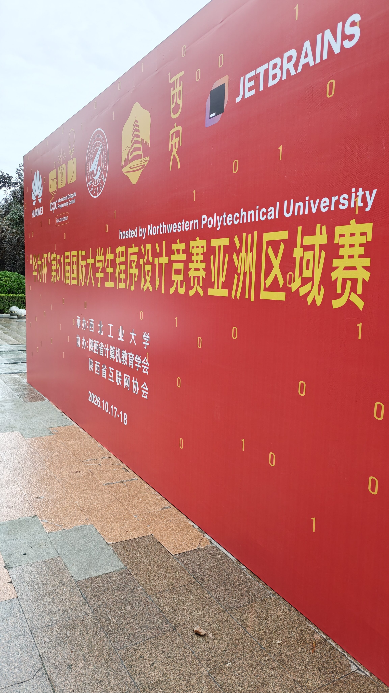
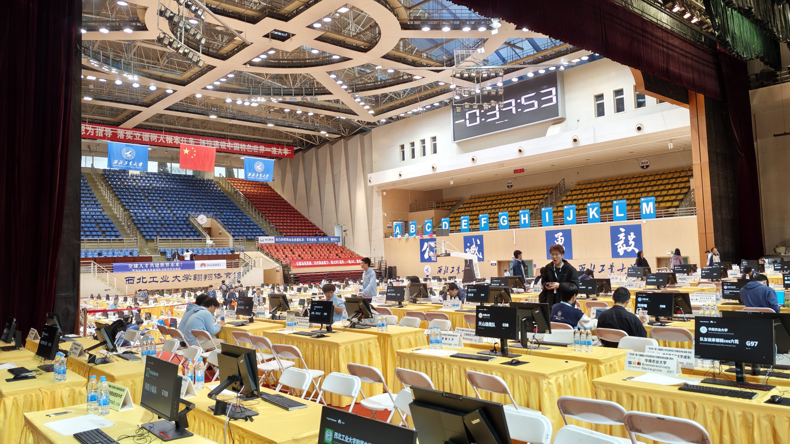
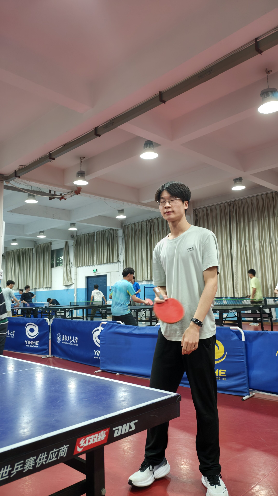

Cocoly 靠夢熊人脈給我們搞來了西安打星名額。感謝 Co 老闆，感謝夢熊信奧🫡，所以隊名是 Mengxiong_Unofficial。

## Day -1

賽站在西北工業大學。從北京坐四五個小時火車，到西安北站，然後再坐一個來小時出租車。西工大太偏僻了，我差點以爲來錯地方了，簡直跟回老家了一樣，兩面環山（學院建在山脈旁邊 +1 科技值），公共交通幾乎沒有。

然而出租車司機（**中共黨員**）提出了他獨特見解。好學校就該在偏遠的地方。所謂「知者樂水，仁者樂山」。繁華地帶的學校，學生出校門就是 KTV，酒吧，檯球館，這樣的學生絕對不是好學生。而且西工大有高精度物理儀器，不能震動，更別提地鐵火車。黨員的思想境界果然不一樣。

可我們返程火車票是四點從西安北出發，西工大卻在西安南邊，打車過去都要至少一個半小時，時間太緊。好在有羣友指點，可以先打車半個小時到鄠邑站，再鄠邑站半個小時高鐵到西安北，總之交通太不便利了。

酒店在西工大東北角的東大村。這個東大村名字太草率了。

## Day 0

報道日。

進校門右轉就能看到大大的 ICPC 參賽院校和贊助商的牌子，但這邊卻並不是進場館方向，得繞半圈才能到真正入口。

中午讓 lcx 帶我們喫飯，有西工大人脈就是不一樣。給三十塊錢餐券，實際能用的窗口很少，而且還只能喫指定的十四元套餐。

下午開幕式大大方方翹，反正打星。然後熱身賽。

我們坐在比賽場最角落的地方，正對着廁所排風口，有股味兒。熱身賽三題，A 交互 B 傳統 C通信。半個小時左右 AB 都過了，然後一起看 C。半個來小時 yl 好像會了，但很難寫，有很多下標 +1 -1 問題，最後十來分鐘 shs 極限過題。

晚上又和高中同學 ymyx 一起打乒乓球。而 yl 雖然習慣用直拍，但在只有橫拍還很不習慣的情況下暴打了我們。

晚上睡得不好，酒店裏頭蓋被子熱不蓋被子冷，還有一種很神祕的低沉轟鳴聲，我不知道到底是什麼樣的機械能發出這種聲音，但總之很晚才睡着，不久就天亮了。

## Day 1

正賽。

挺牢的，可以詳見 https://www.zhihu.com/question/2090976200508306431 了解網友評價。

題組得確實不太好，難度梯度太大了。有三十來只隊驗題，jiangly 只過 8 題，最好還是能聽一點反饋。

開局 shs M 題簽到讀錯題，貢獻一發罰時，奠定比賽基調。我以爲 B 可做，糊了個簡單換根 dp，結果 WA 了。經 yl 診斷，感覺好像救不了。然後 C 和 H 都做得很掙扎。兩個半小時總共過了四題，然後巨大自閉。我通讀題面，感覺都沒什麼可做的。最後一小時 yl 提供神祕做法過了 G，然後又指導 shs 過了 L。太偉大了 yl，我們隊沒有 yl 都不知道怎麼辦。

如果是 CCPC 新賽制，除了前四道題，其他題應該都是不能解榜的，那只能更自閉了。

不過總歸還是取得了比較好的成績，是個好的開始。
